

  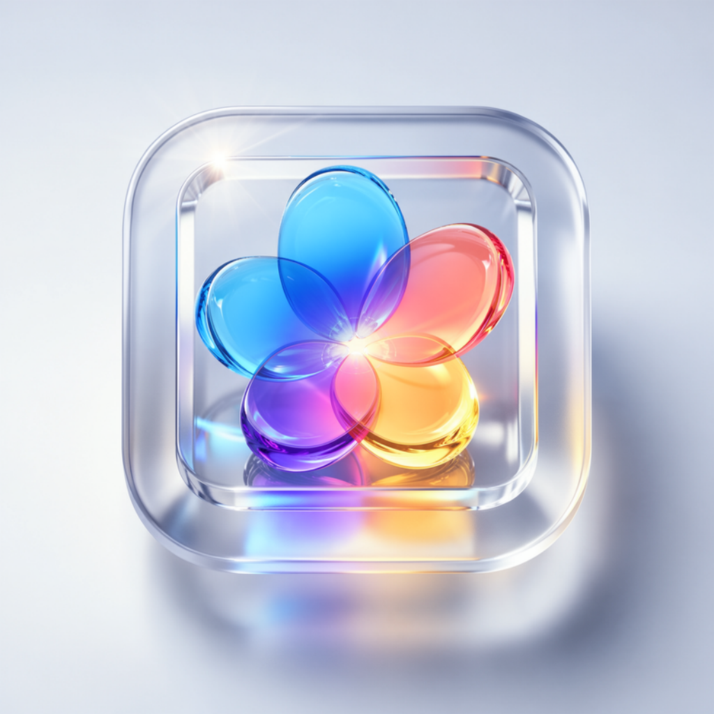

# Widglass

Desktop widgets for Windows in the style of macOS widgets: frosted glass, rounded corners and the soft blue → pink → orange colors of the logo.

  <a href="https://github.com/gigilucas/Widglass/releases/latest/download/Widglass.exe"><b>⬇ Download Widglass for Windows</b></a>
  &nbsp;·&nbsp;
  <a href="https://gigi-apps.github.io">gigi-apps.github.io</a>

## Download

1. Download **[Widglass.exe](https://github.com/gigilucas/Widglass/releases/latest/download/Widglass.exe)**.
2. Open it. That's all: **nothing else to install**, everything works right away.

- Works on Windows 10 (1809 or later) and Windows 11.
- The first time, Windows may say *"Windows protected your PC"*: click **More info** and then **Run anyway**.
- Widglass then sits in the notification area (the **^** arrow next to the clock) and starts with Windows.
- Keep the file somewhere it can stay (for example a *Widglass* folder in *Documents*), since Windows opens it from there at startup.

All versions are on the [Releases page](https://github.com/gigilucas/Widglass/releases). More apps by the same author: **[gigi-apps.github.io](https://gigi-apps.github.io)**.

  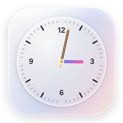
  
  
  
  

Clock · CPU / RAM · Calendar · Weather · Music — screenshots of the real app

## How it works

The app lives in the **notification area** (the **^** arrow next to the clock on the taskbar), not on the taskbar like a normal app. **Click its icon** to open the menu; right-click it for *Open Widglass*, *Start with Windows* and *Quit*.

The menu lists the five widgets.

  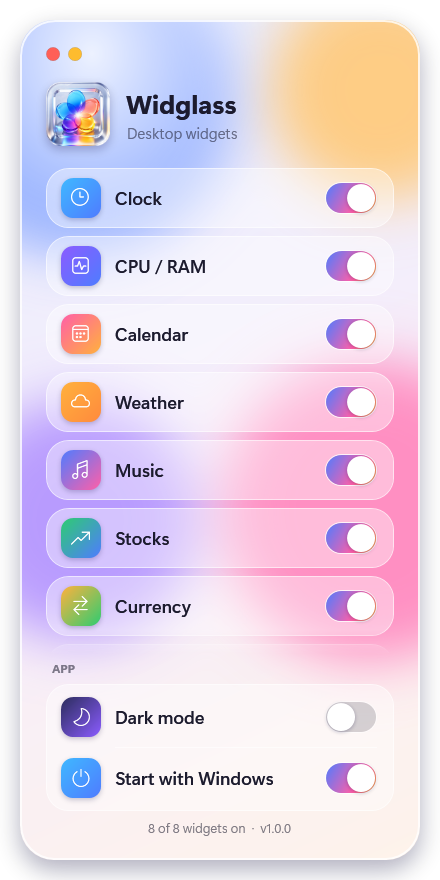
  
  

- **On/off switch**: shows or hides that widget on the desktop.
- **Click a row** (not the switch): opens that widget's settings. **‹ Widgets** goes back.
- **Pinned to the desktop**: widgets live on the desktop like the wallpaper. They stay behind every other window, even when you click them, and they stay visible on *Show desktop* (Win+D). To reach them, show the desktop or move the windows out of the way.
- **Drag a widget** anywhere on the screen; its position is remembered.
- **Always whole on a screen**: a widget can't go past the screen edges or under the taskbar. With more than one monitor you can drag it from screen to screen; it jumps over when its center crosses, so it never sits half on each. If a monitor is unplugged or the resolution changes, widgets move back onto a screen.
- **Widgets never cover each other**: they can touch, but if you drag one onto another it slides out the shortest way and stays edge to edge. A widget that opens where another one already is moves to the nearest free spot.
- **Dark mode** (under *App*): switches the menu and all the widgets to dark at once. See [Dark mode](#dark-mode).
- **Start with Windows** (under *App*, on by default): when the PC starts, the widgets appear on the desktop and the icon goes to the notification area; the menu stays closed until you click the icon.
- The red and yellow buttons tuck the menu away into the notification area; the widgets keep running. To close everything, right-click the icon and choose **Quit**.
- Only one copy runs at a time: opening the app again just brings up its menu.
- Widgets don't show up in the taskbar or in Alt+Tab.
- Your choices are saved in `%AppData%\Widglass\settings.json`, and the widgets that were on come back the next time the app starts.

## Widgets

### Clock

  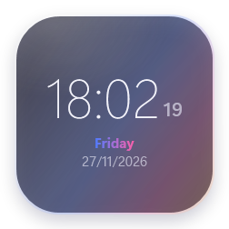

- Time and time zone come from this PC.
- **Style** (in settings): **Analog**, a clock face with hour, minute and second hands, or **Digital**, big numbers with seconds, the weekday and the date. The change applies right away.
- Digital follows the PC's 12/24-hour setting.

### Calendar

- The date comes from this PC and is shown as **dd/mm/yyyy**, with the weekday on top.
- Month view with today highlighted; it rolls over by itself at midnight.
- The week starts on the day set in the PC's region settings.

### Weather

- Uses **this PC's location** (Windows location services).
- Shows the place, the current temperature and conditions with an icon (sun, moon, clouds, rain, snow, storm, fog), today's high/low, and **today plus the next 4 days** (high and low).
- Updates every 15 minutes. Units: Celsius.
- If Windows location is off, the widget says so and its settings have a button that opens the Windows location page.
- Forecast by [Open-Meteo](https://open-meteo.com) and place name by [BigDataCloud](https://www.bigdatacloud.com), both free and without an account. The coordinates are rounded to about 1 km before they leave the PC.

### CPU / RAM

- Two rings with live **CPU usage** and **memory usage**, updated every second.
- Under CPU: the current **speed** (GHz), the same number Task Manager shows. Under RAM: used / total GB.
- The CPU temperature isn't shown: Windows doesn't share it without admin rights or extra drivers.
- Settings show the processor name, threads and total memory.

### Music

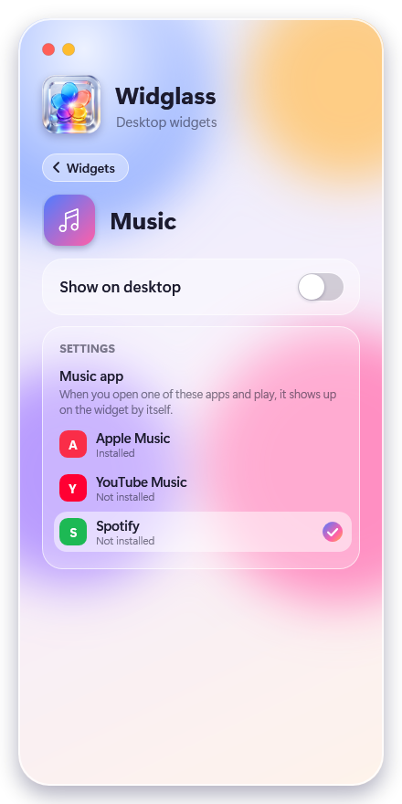

- Works with **Apple Music**, **YouTube Music** and **Spotify**. All three are always listed in settings, marked *Installed* or *Not installed*.
- When you open one of these apps and play, it **shows up on the widget by itself**. If more than one is playing, the app chosen in settings wins.
- Shows the album art, song, artist, which app it comes from, and a progress bar with elapsed and remaining time.
- Controls: play/pause, previous, next, shuffle and repeat. Buttons the app doesn't support are dimmed.
- **Jump in a song** by clicking or dragging the progress bar, **except in Apple Music**: Apple Music for Windows doesn't let other apps change the song position, so there the bar only shows progress. Spotify and YouTube Music allow it.
- Browsers are ignored (a video playing in Edge never shows up). YouTube Music counts only when it's **installed as an app**: open [music.youtube.com](https://music.youtube.com) in Chrome or Edge and choose *Install YouTube Music*.
- When nothing is playing, the widget shows *Not playing* and a button to open the chosen app, or to get it from the Microsoft Store if it isn't installed.
- It reads and controls the music through the Windows media controls (the same ones the volume flyout uses), so no login is needed.

## Dark mode

Turn on **Dark mode** in the menu, under *App*. The menu and every widget on the desktop change right away, and the choice is saved.

The widgets become smoked dark glass with white text, and keep the logo colors in the clock hands, rings, today's date, the play button and the progress bar.

  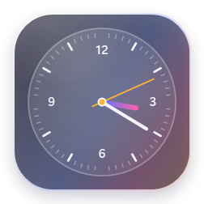
  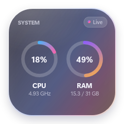
  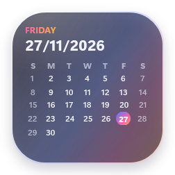
  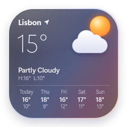
  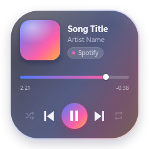

  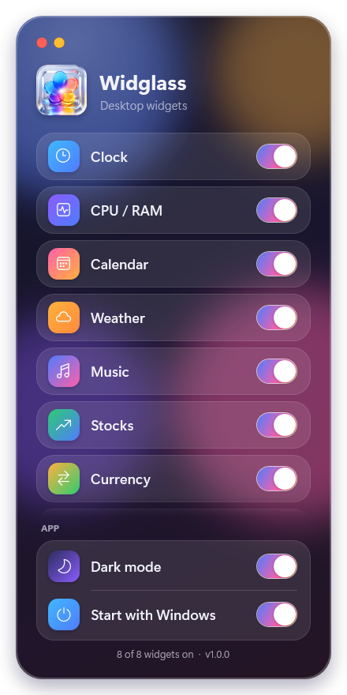
  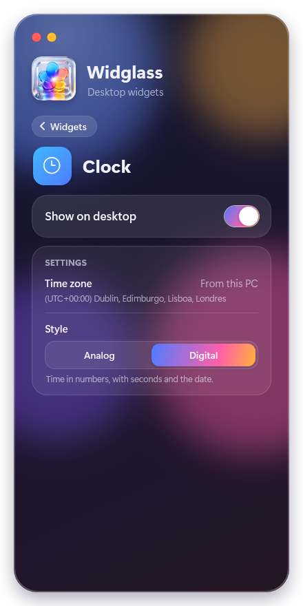
  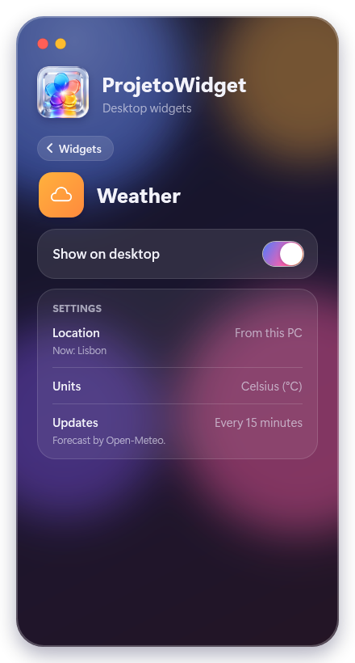

## Source code

Widglass is written in C# / WPF. To build it yourself or change the code, see [docs/DEVELOPING.md](docs/DEVELOPING.md). To just use the app, you only need the download above.
