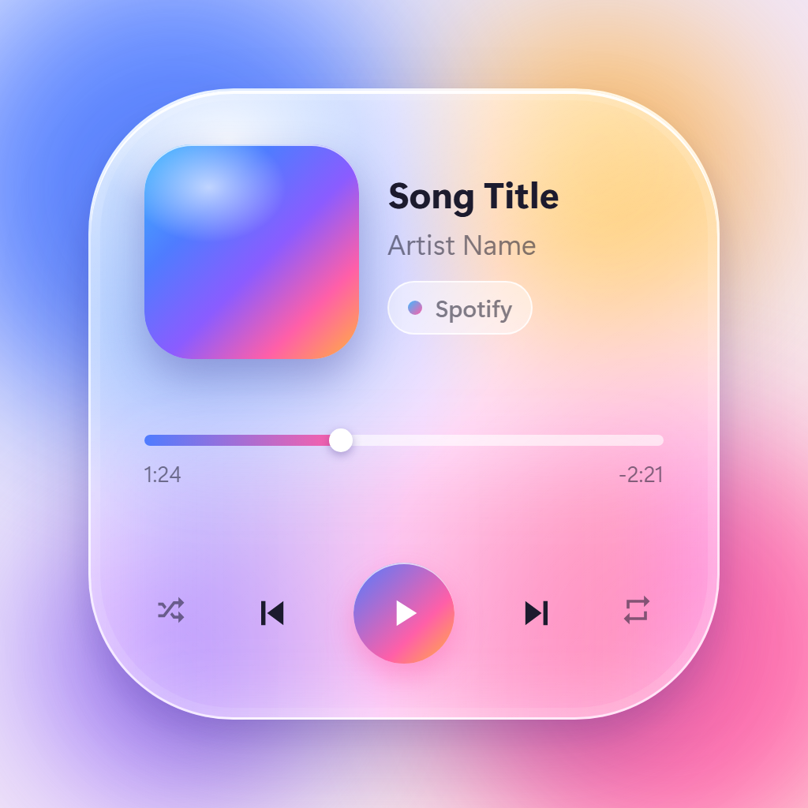



  

# ProjetoWidget

Desktop widgets for Windows in the style of macOS widgets: clean, simple, square, with rounded corners, and pinned to the wallpaper.

The app ships as a `.exe` for PC.

## Goals

- Clean, square widgets with rounded corners, inspired by macOS.
- Widgets are **pinned to the wallpaper**: they don't show up in the taskbar, never sit on top of other windows, and stay on the desktop background.
- Every widget can be **dragged** anywhere on the screen, and its position is saved.
- A **small manager window** to pick which widgets are shown.

## Widgets

| Widget | Description |
| --- | --- |
| **Clock** | Analog clock with the digital time underneath. |
| **CPU / RAM** | Live CPU usage and temperature, plus memory usage. |
| **Calendar** | Current month view with today highlighted. |
| **Weather** | Temperature, conditions and city. |
| **Music** | Album art and playback controls (previous, play/pause, next, volume), connected to Spotify, Apple Music or any other music app. |

## Visual references

Glass-style mockups of the five widgets, based on the first Canva sketches (design **City**) and on the app logo: frosted translucent cards with rounded corners, a soft blue → pink → orange palette and only the essential information. They aren't final.

The mockups are built in [`design/widget-mockups.html`](design/widget-mockups.html) and exported to PNG with [`design/render.ps1`](design/render.ps1) (headless Microsoft Edge).

| Clock | CPU / RAM | Calendar | Weather | Music |
| --- | --- | --- | --- | --- |
|  |  |  |  |  |

## Window behavior

The key part of the project is making each widget behave like part of the desktop:

- **No taskbar entry**: widget windows don't appear in the taskbar or in Alt+Tab.
- **Pinned to the background**: widgets sit behind normal windows, at the same level as the desktop icons, and stay visible after "Show desktop" (Win+D).
- **Free dragging**: click and drag to move a widget; the position is remembered on the next launch.
- **Start with Windows** (optional).

## Technical notes (proposal)

- To pin widgets to the wallpaper, each window is parented to Windows' `WorkerW`/`Progman` window (the same layer that holds the desktop icons).
- The **Music** widget can use the Windows media session API (`GlobalSystemMediaTransportControlsSessionManager`), which works with Spotify, Apple Music and other apps without any login.
- The **Weather** widget uses a public weather API.
- Tech stack still to be decided (for example C# / .NET with WPF).

## Status

🚧 Early stage: defining the design and the project structure.
