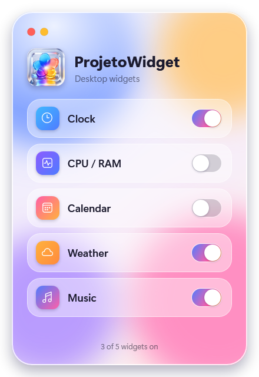
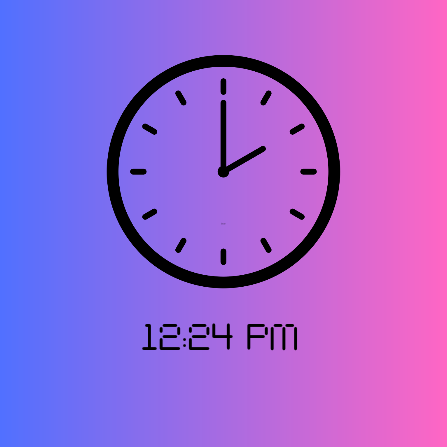
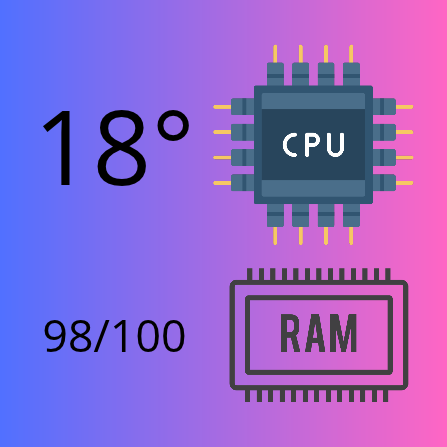
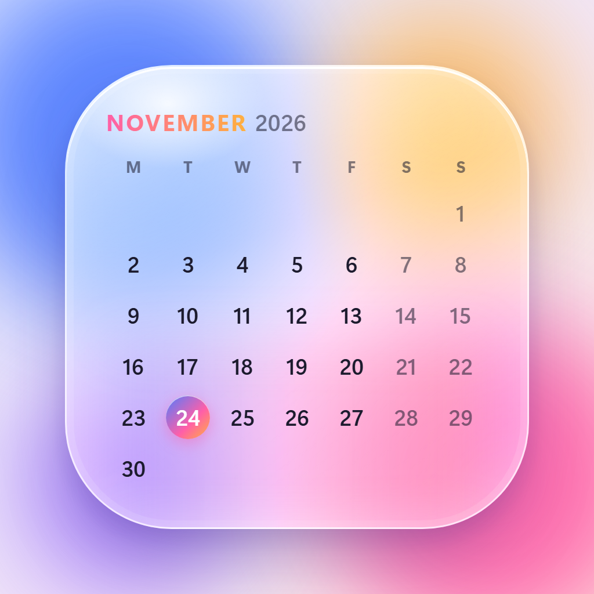

<p align="center">
  
</p>

# ProjetoWidget

Desktop widgets for Windows in the style of macOS widgets: clean, simple, square, with rounded corners, and pinned to the wallpaper.

The app ships as a `.exe` for PC.

## Goals

- Clean, square widgets with rounded corners, inspired by macOS.
- Widgets are **pinned to the wallpaper**: they don't show up in the taskbar, never sit on top of other windows, and stay on the desktop background.
- Every widget can be **dragged** anywhere on the screen, and its position is saved.
- A **small manager window** to pick which widgets are shown.

## Widgets

| Widget | Description |
| --- | --- |
| **Clock** | Analog clock with the digital time underneath. |
| **CPU / RAM** | Live CPU usage and temperature, plus memory usage. |
| **Calendar** | Current month view with today highlighted. |
| **Weather** | Temperature, conditions and city. |
| **Music** | Album art and playback controls (previous, play/pause, next, volume), connected to Spotify, Apple Music or any other music app. |

## The app

The manager window lists the five widgets, each with an Apple-style on/off switch. It uses the same glass look and colors as the logo. Your choices are saved in `%AppData%\ProjetoWidget\settings.json`.

<p align="center">
  
</p>

> The switches only save your choice for now; the widgets themselves come next.

## Visual references

Glass-style mockups of the five widgets, based on the first Canva sketches (design **City**) and on the app logo: frosted translucent cards with rounded corners, a soft blue → pink → orange palette and only the essential information. They aren't final.

The mockups are built in [`design/widget-mockups.html`](design/widget-mockups.html) and exported to PNG with [`design/render.ps1`](design/render.ps1) (headless Microsoft Edge).

<p align="center">
  
  
  
  
  
</p>
<p align="center"><sub>Clock · CPU / RAM · Calendar · Weather · Music</sub></p>

## Window behavior

The key part of the project is making each widget behave like part of the desktop:

- **No taskbar entry**: widget windows don't appear in the taskbar or in Alt+Tab.
- **Pinned to the background**: widgets sit behind normal windows, at the same level as the desktop icons, and stay visible after "Show desktop" (Win+D).
- **Free dragging**: click and drag to move a widget; the position is remembered on the next launch.
- **Start with Windows** (optional).

## Tech stack

- **C# / .NET 10 / WPF**: a native Windows desktop app, published as a single `.exe`.
- To pin widgets to the wallpaper, each widget window will be parented to Windows' `WorkerW`/`Progman` window (the same layer that holds the desktop icons).
- The **Music** widget will use the Windows media session API (`GlobalSystemMediaTransportControlsSessionManager`), which works with Spotify, Apple Music and other apps without any login.
- The **Weather** widget will use a public weather API.

## Getting started

Requirements: Windows 10/11 and the [.NET 10 SDK](https://dotnet.microsoft.com/download).

Run from source:

```powershell
dotnet run --project src/ProjetoWidget
```

Build the `.exe` (self-contained, no .NET install needed on the target PC):

```powershell
dotnet publish src/ProjetoWidget -c Release -r win-x64 --self-contained true -p:PublishSingleFile=true -p:IncludeNativeLibrariesForSelfExtract=true -p:EnableCompressionInSingleFile=true -o publish
```

The app ends up in `publish/ProjetoWidget.exe`.

Other helpers:

- `ProjetoWidget.exe --screenshot out.png` saves an image of the manager window and exits.
- [`tools/make-icon.ps1`](tools/make-icon.ps1) rebuilds the app icon from `docs/logo.png`.

## Project structure

```
src/ProjetoWidget/        WPF app (manager window, settings, assets)
design/                   HTML mockups of the widgets and the script that exports them
docs/                     Logo, app screenshot and widget reference images
tools/                    Helper scripts
```

## Status

🚧 Manager window done (list of widgets with on/off switches). Next: the widget windows themselves, pinned to the wallpaper.
