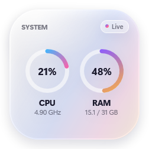
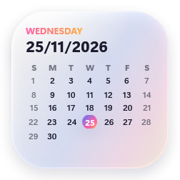
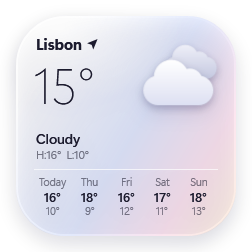
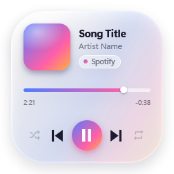
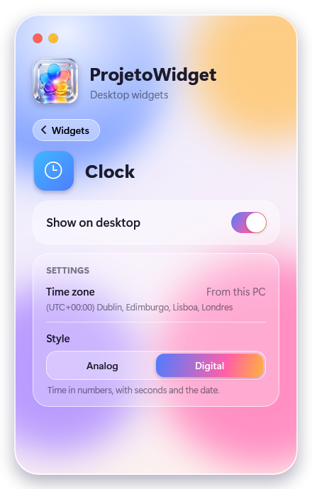
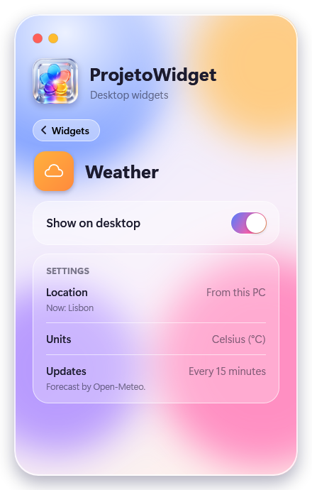
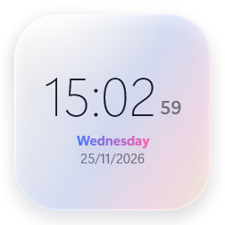

<p align="center">
  
</p>

# ProjetoWidget

Desktop widgets for Windows in the style of macOS widgets: frosted glass, rounded corners and the soft blue → pink → orange colors of the logo.

The app ships as a single `.exe` for PC.

<p align="center">
  
  
  
  
  
</p>
<p align="center"><sub>Clock · CPU / RAM · Calendar · Weather · Music — screenshots of the real app</sub></p>

## How it works

The app opens a small manager window that lists the five widgets.

<p align="center">
  
  
  
</p>

- **On/off switch**: shows or hides that widget on the desktop.
- **Click a row** (not the switch): opens that widget's settings. **‹ Widgets** goes back.
- **Drag a widget** anywhere on the screen; its position is remembered.
- Widgets don't show up in the taskbar or in Alt+Tab.
- Your choices are saved in `%AppData%\ProjetoWidget\settings.json`, and the widgets that were on come back the next time you open the app.
- Closing the manager window (red button) closes the app and its widgets.

## Widgets

### Clock

 

- Time and time zone come from this PC.
- **Style** (in settings): **Analog**, a clock face with hour, minute and second hands, or **Digital**, big numbers with seconds, the weekday and the date. The change applies right away.
- Digital follows the PC's 12/24-hour setting.

### Calendar

- The date comes from this PC and is shown as **dd/mm/yyyy**, with the weekday on top.
- Month view with today highlighted; it rolls over by itself at midnight.
- The week starts on the day set in the PC's region settings.

### Weather

- Uses **this PC's location** (Windows location services).
- Shows the place, the current temperature and conditions with an icon (sun, moon, clouds, rain, snow, storm, fog), today's high/low, and **today plus the next 4 days** (high and low).
- Updates every 15 minutes. Units: Celsius.
- If Windows location is off, the widget says so and its settings have a button that opens the Windows location page.
- Forecast by [Open-Meteo](https://open-meteo.com) and place name by [BigDataCloud](https://www.bigdatacloud.com), both free and without an account. The coordinates are rounded to about 1 km before they leave the PC.

### CPU / RAM

- Two rings with live **CPU usage** and **memory usage**, updated every second.
- Under CPU: the current **speed** (GHz), the same number Task Manager shows. Under RAM: used / total GB.
- The CPU temperature isn't shown: Windows doesn't share it without admin rights or extra drivers.
- Settings show the processor name, threads and total memory.

### Music


- Works with **Apple Music**, **YouTube Music** and **Spotify**. All three are always listed in settings, marked *Installed* or *Not installed*.
- When you open one of these apps and play, it **shows up on the widget by itself**. If more than one is playing, the app chosen in settings wins.
- Shows the album art, song, artist, which app it comes from, and a progress bar with elapsed and remaining time.
- Controls: play/pause, previous, next, shuffle and repeat. Buttons the app doesn't support are dimmed.
- **Jump in a song** by clicking or dragging the progress bar, **except in Apple Music**: Apple Music for Windows doesn't let other apps change the song position, so there the bar only shows progress. Spotify and YouTube Music allow it.
- Browsers are ignored (a video playing in Edge never shows up). YouTube Music counts only when it's **installed as an app**: open [music.youtube.com](https://music.youtube.com) in Chrome or Edge and choose *Install YouTube Music*.
- When nothing is playing, the widget shows *Not playing* and a button to open the chosen app, or to get it from the Microsoft Store if it isn't installed.
- It reads and controls the music through the Windows media controls (the same ones the volume flyout uses), so no login is needed.

## Not done yet

- **Pin the widgets to the wallpaper**: for now they are normal windows that stay where you put them but can sit on top of other windows. The plan is to attach them to Windows' `WorkerW`/`Progman` desktop layer so they stay behind everything and survive *Show desktop* (Win+D).
- Start with Windows.

## Tech stack

- **C# / .NET 10 / WPF**, targeting the Windows 10 SDK (for location and media controls). Published as one self-contained `.exe`.
- Windows APIs: `Windows.Devices.Geolocation` (location), `GlobalSystemMediaTransportControlsSessionManager` (music), performance counters and `GlobalMemoryStatusEx` (CPU / RAM).

## Getting started

Requirements: Windows 10 (1809 or later) or Windows 11, and the [.NET 10 SDK](https://dotnet.microsoft.com/download) to build.

Run from source:

```powershell
dotnet run --project src/ProjetoWidget
```

Build the `.exe` (self-contained, no .NET install needed on the target PC):

```powershell
dotnet publish src/ProjetoWidget -c Release -r win-x64 --self-contained true -p:PublishSingleFile=true -p:IncludeNativeLibrariesForSelfExtract=true -p:EnableCompressionInSingleFile=true -o publish
```

The app ends up in `publish/ProjetoWidget.exe`.

### Developer options

| Option | What it does |
| --- | --- |
| `--screenshot out.png` | Saves an image of the manager window and exits. |
| `--screenshot out.png --page clock` | Same, showing that widget's settings. |
| `--screenshot out.png --widget weather` | Saves an image of one widget instead. |
| `--location 38.72,-9.14` | Uses these coordinates for the weather instead of the PC's location. |
| `--music-test FakePlayer:Spotify` | Lets the Music widget follow a test media session whose id contains `FakePlayer`, labelled *Spotify*. |

The screenshots in this README were made with these options. [`tools/make-icon.ps1`](tools/make-icon.ps1) rebuilds the app icon from `docs/logo.png`.

## Project structure

```
src/ProjetoWidget/
  MainWindow.xaml        Manager window: widget list, settings pages
  WidgetWindow.xaml      One widget on the desktop (glass card)
  Widgets/               Content and settings view of each widget
  Services/              Weather, music and CPU / RAM data
  Settings.cs            Saved choices
docs/                    Logo and screenshots
design/                  Early HTML mockups of the widgets
tools/                   Helper scripts
```
