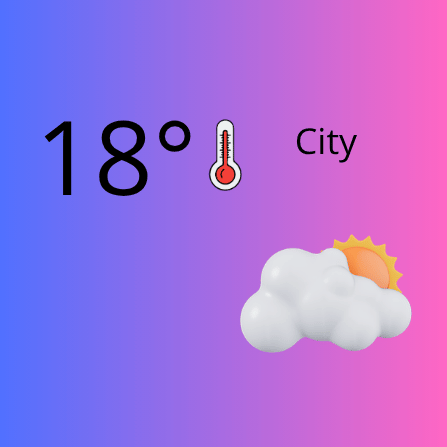

# ProjetoWidget

Widgets para o ambiente de trabalho do Windows, ao estilo dos widgets do macOS: bonitos, de cantos arredondados, simples e quadrados, presos ao wallpaper.

A aplicação é distribuída como um `.exe` para PC.

## Objetivo

- Widgets com visual limpo, quadrados e de cantos arredondados, inspirados no macOS.
- Os widgets ficam **agarrados ao wallpaper**: não aparecem na barra de tarefas, não ficam por cima das outras janelas e mantêm-se no fundo do ambiente de trabalho.
- Cada widget pode ser **arrastado** para qualquer posição do ecrã, e a posição fica guardada.
- Uma **pequena interface de gestão** para escolher que widgets mostrar.

## Widgets

| Widget | Descrição |
| --- | --- |
| **Relógio** | Relógio analógico com a hora digital por baixo. |
| **CPU / RAM** | Utilização e temperatura do processador e uso da memória em tempo real. |
| **Calendário** | Vista do mês atual com o dia de hoje assinalado. |
| **Tempo** | Temperatura, estado do tempo e cidade. |
| **Música** | Capa do álbum e controlos de reprodução (anterior, play/pausa, seguinte, volume), ligado ao Spotify, Apple Music ou outra app de música. |

## Referências visuais

Imagens de referência feitas no Canva (design **City**). Não são as finais, mas mostram o estilo pretendido: fundo em gradiente azul → rosa, ícones grandes e informação essencial.

| Relógio | CPU / RAM | Calendário | Tempo | Música |
| --- | --- | --- | --- | --- |
|  |  |  |  |  |

## Comportamento da janela

O ponto mais importante do projeto é cada widget comportar-se como parte do ambiente de trabalho:

- **Sem barra de tarefas**: as janelas dos widgets não aparecem na barra de tarefas nem no Alt+Tab.
- **Preso ao fundo**: o widget é colocado atrás das janelas normais, ao nível dos ícones do ambiente de trabalho, e continua visível quando se usa "Mostrar ambiente de trabalho" (Win+D).
- **Arrastar livremente**: clicar e arrastar move o widget, e a posição é guardada para o próximo arranque.
- **Arranque com o Windows** (opcional).

## Notas técnicas (proposta)

- Para prender os widgets ao wallpaper, a janela é associada à janela `WorkerW`/`Progman` do Windows (a mesma camada onde ficam os ícones do ambiente de trabalho).
- O widget de **música** pode usar a API de sessões de media do Windows (`GlobalSystemMediaTransportControlsSessionManager`), que funciona com o Spotify, Apple Music e outras apps sem precisar de login.
- O widget de **tempo** usa uma API meteorológica pública.
- Stack ainda por decidir (por exemplo C# / .NET com WPF).

## Estado

🚧 Em fase inicial: definição do design e da estrutura do projeto.
